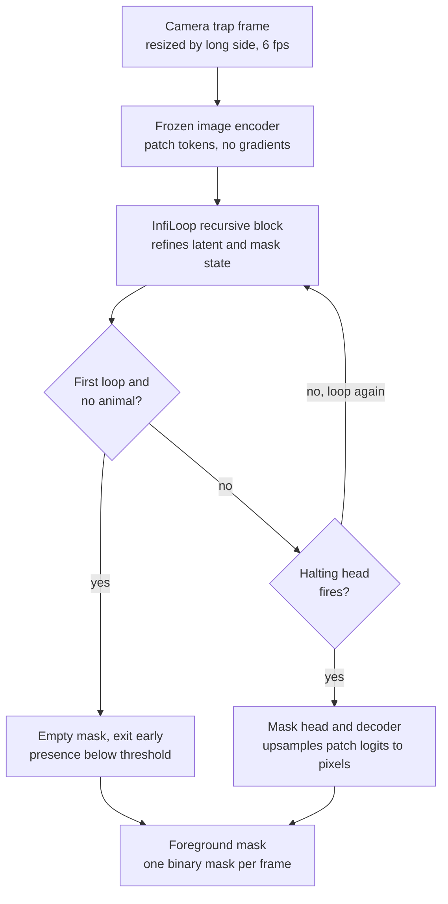

# InfiLoop Animal Segmentation on SA-FARI, Implementation Strategy

Nov 17, 2026 · Nathan Schneider Gavenski

## Goal and scope

We will build a per-frame animal foreground segmenter for camera trap video whose depth adapts to how hard each frame is. A frozen pretrained encoder supplies patch features, an InfiLoop recursive block refines a foreground mask over the patch grid, and the TRM halting head doubles as the animal presence gate, so confidently empty frames exit after the first loop.

Work runs in two stages. Stage A trains and evaluates on SA-FARI alone (access approved on Hugging Face). Stage B adds our own camera trap footage, labelled with SAM 3 pseudo-masks, and fine-tunes the Stage A model on it.

The prototype counts as a success when it meets these targets.

- Foreground IoU on the SA-FARI test split is competitive with zero-shot SAM 3 prompted with "animal", at a fraction of its inference cost.
- IoU rises with test-time loop count, and most of the gain lands on small instances and hard frames.
- Presence recall at the chosen exit threshold meets a target agreed with the UCL partner (0.99 proposed as a starting point), since a missed animal costs more than an extra loop.

Species classification, instance identities and tracking are out of scope for now. A single binary mask per frame is the only output.

## Architecture

Only the recursive block, the decoder and the heads are trained. The encoder stays frozen throughout Stage A.



Each loop updates the latent and the mask state. The presence check runs once after the first loop, and the halting head decides when every later loop stops.

## Phase 0, environment and data access

Phase 0 ends when one SA-FARI frame and its union mask render correctly in a notebook on the HPC.

- [ ] Clone the [InfiLoop repository](https://github.com/pixeli99/InfiLoop) and the public TRM codebase it builds on. Keep both as upstream references and copy only the recursive block into our repo.
- [ ] Build one Python environment for KCL HPC with PyTorch, FlashAttention or SDPA, pycocotools, and the `sam3` package (needed for the zero-shot baseline and for Stage B pseudo-labels).
- [ ] Download the annotation files from [facebook/SA-FARI](https://huggingface.co/datasets/facebook/SA-FARI). These are `sa_fari_train.json`, `sa_fari_test.json` and their `_ext` versions, which add frame counts, FPS, location IDs and taxonomy.
- [ ] Download only the `JPEGImages_6fps` folders from the `cxl-public-camera-trap` location named on the dataset card. The masks are aligned to these frames, so the full-rate videos are unnecessary for Stage A. Check the total size before pulling it to shared storage.
- [ ] Point MLflow at a file store on the HPC so runs follow the same conventions as the team's AWS setup.
- [ ] Record licences in the README. SA-FARI is CC-BY-NC 4.0 and SAM 3 weights are gated under the SAM License, so every Stage A artefact is non-commercial.

## Phase 1, SA-FARI data pipeline

Phase 1 turns SA-FARI into per-frame binary masks with presence labels, and fixes the training resolution with a measured rule instead of a guess.

1. **Union masks.** Parse the YTVIS-style annotations, decode the RLE masks of every masklet in a frame across all species, and take their union. The presence label is 1 when the union is non-empty.
2. **Instance index.** Store one row per instance per frame with area, bounding box, species, video ID, location ID and any difficulty tag from the `_ext` files. Every later stratification reads from this table.
3. **Resolution study.** Videos range from 320×194 to 2688×1234. For candidate long sides of 768, 1024, 1344 and 1536 px and patch sizes of 14 and 16, count the instances that would cover less than one patch and less than four. Choose the smallest long side at which at least 99% of instances cover one patch or more (proposed rule, adjust after seeing the numbers).
4. **Validation split.** SA-FARI ships train and test only. Hold out about 5% of training locations as validation, splitting by location ID so no camera appears in both.
5. **Resizing and batching.** Resize by long side with the aspect ratio kept, pad to a multiple of the patch size, and carry a padding mask into the loss. Bucket batches by aspect ratio.
6. **Frame sampling.** Neighbouring frames at 6 fps are nearly identical, so sample a few frames per video per epoch. Stratify the draw so frames without animals are included.
7. **Flock flags.** Animals too blurred or indistinct to annotate, such as birds in a flock, appear as background in the target. Flag videos where zero-shot SAM 3 finds substantial foreground outside the union mask, and report them separately.
8. **Augmentation.** Use horizontal flips, mild colour jitter, random greyscale (to imitate infrared night frames), and scale crops centred on small animals.

## Phase 2, baselines

Three baselines fix the floor and the ceiling before any looping is trained. B1 is the key comparison, because it shares every component with the full model except the loops.

| ID | Model | What it isolates |
| --- | --- | --- |
| B0 | Frozen encoder, linear per-patch probe, bilinear upsampling | How much the encoder features alone already segment animals |
| B1 | Frozen encoder, the Phase 3 decoder, one pass with no recursion | The contribution of the loops, once compared with Phase 3 |
| B2 | Zero-shot SAM 3.1 with the prompt "animal", predicted masks merged per frame | The external reference the prototype has to approach |

The encoder is chosen with B0 on the validation split. Candidates are DINOv3 (accepts variable input sizes), BioCLIP 2 and the SAM 3 encoder (fixed at 1008 px). Check each candidate's licence before committing. Running B2 with the ground-truth species names as prompts gives an oracle reference, but report it separately because it leaks labels.

## Phase 3, InfiLoop segmenter

Phase 3 trains the recursive block on top of the frozen encoder, with mask loss only, and has to beat B1 on validation before Phase 4 starts.

- **Input.** Patch tokens from the frozen encoder, run in bf16 with no gradients, projected to the InfiLoop hidden size of 512.
- **Recursive block.** Port the InfiLoop residual connection into TRM's nested recursion, keeping the latent state and an answer state that here holds per-token mask logits. Keep the published block shape (two transformer layers, eight heads, SwiGLU, depthwise 3×3 convolution). Reshape tokens to the 2D patch grid of each bucket before the convolution, and use 2D positional encodings.
- **Decoder.** A light upsampling decoder, in the style of the SAM mask decoder, turns per-token logits into a full-resolution mask. Feeding it the downsampled RGB frame as a guide helps recover thin legs, tails and ears.
- **Training.** Use TRM's deep supervision with a loss at every supervision step, backpropagate only through the last recursion, and keep an EMA of the weights as TRM does. Start from the InfiLoop ARC configuration for recursion counts and learning rate, then tune on validation.
- **Loss.** BCE plus Dice, computed at mask resolution with the padding mask applied. If small instances still lag, add per-instance normalisation or focal weighting so a small rodent is not drowned out by background.
- **Compute.** Attention over the full patch grid dominates the cost (up to 4,096 tokens at a 1024 px long side with 16 px patches, fewer for wide frames). Use SDPA or FlashAttention, aspect-ratio buckets and bf16. If memory runs out, fall back to windowed attention inside the block before shrinking the input.

## Phase 4, halting gate as presence classifier

The TRM halting head is the gate, so empty frames stop after one loop and uncertain frames, often those with small animals, get the most compute.

- **Halting target.** TRM trains the halting head to predict whether the current answer is already correct. For a frame with animals, correct means IoU with the target of at least τ (start at 0.8 and tune). For an empty frame, correct means the predicted foreground stays below a small pixel count ε.
- **Explicit presence logit.** A second head on the same latent predicts p(animal) after loop 1 and is trained with BCE. It drives the early exit and is exported per trigger, since the UCL side needs a clear animal or no-animal output.
- **Inference policy.** After loop 1, exit with an empty mask if p(animal) is below t_empty. Otherwise keep looping until the halting head fires or the loop cap is reached. Set t_empty on validation so presence recall meets the agreed target, which makes the exit asymmetric and keeps doubtful frames looping.
- **Class balance.** SA-FARI contains no empty videos, so its negatives are frames before an animal enters or after it leaves. Reweight them now, and recalibrate t_empty in Stage B on real empty triggers.
- **What to log.** Presence precision and recall, mean loops per frame for empty and positive frames, and wall-clock time saved against a fixed loop count.

## Phase 5, evaluation protocol

The headline result is a curve of IoU against loop count, split by instance size and difficulty. The tables below back it up.

**Metrics.** Mean per-frame foreground IoU, global IoU over all pixels, boundary F-score, presence precision and recall, mean loops per frame, and latency per frame on a fixed GPU. Write our own metric script with unit tests. SAM 3's offline evaluator reads SA-FARI annotations but scores concept segmentation, so use it only for sanity checks.

**Strata.** Report every metric overall and split by these groups.

| Stratum | How it is defined |
| --- | --- |
| Instance size | Small, medium and large, using COCO thresholds of 32² and 96² px in original resolution |
| Day or night | Night when all three colour channels are equal (infrared) |
| Difficulty | The difficulty tags in the SA-FARI test metadata |
| Species | Per species category, with the long tail grouped |
| Flock flag | Videos flagged in Phase 1, reported apart from the rest |

**Loop-count curve.** Disable halting and evaluate at fixed loop counts of 1, 2, 4, 8, 16, 32 and 64. Plot IoU per stratum, then mark where adaptive halting lands on each curve. A curve that rises and then falls is the overthinking effect described in the InfiLoop paper, and it is worth reporting for vision too.

**Comparison.** One table with B0, B1, B2 and the full model, all on the same SA-FARI test frames at the same resolution.

## Phase 6, own footage with SAM 3 pseudo-labels

Stage B fine-tunes the Stage A checkpoint on our footage, labelled by SAM 3.1, and is judged against a small set of frames checked by hand.

1. **Ingest.** Decode each video to 6 fps JPEGs in the same folder layout as SA-FARI, so the Phase 1 loader works unchanged.
2. **Pseudo-label.** Run the SAM 3.1 video predictor with the prompt "animal", plus species prompts when the UCL partner knows which species to expect. Merge masklets per frame and keep the confidence scores.
3. **Audit set.** Hand-check a stratified sample of frames (day and night, small and large animals, empty triggers) and correct the masks. Use this set only for testing. A model trained on SAM 3 labels and scored against SAM 3 labels would just reward imitating SAM 3.
4. **Noisy-label handling.** Ignore a thin band of pixels along each pseudo-mask boundary in the loss, and down-weight low-confidence frames.
5. **Empty triggers.** Real empties from our cameras (wind, vegetation, light changes) are the main thing SA-FARI lacks. Use them to recalibrate t_empty and the presence head.
6. **Fine-tune.** Start from the Stage A checkpoint with a lower learning rate. Replay a share of SA-FARI frames to avoid forgetting, and keep the encoder frozen. Unfreeze its last blocks only if a clear gap remains on the audit set.
7. **Deployment check.** Once the target hardware is known, export the model and measure latency and memory per frame with adaptive halting on.

## Repository layout, configs and logging

One repository with YAML configs per experiment, so every baseline and ablation is a config change plus one HPC job script.

```
camtrap-loop/
  configs/            # one YAML per experiment (B0, B1, B2, loop, halt, stage_b)
  data/
    sa_fari.py        # annotation parsing, union masks, instance index
    own_footage.py    # Stage B loader, same interface
    buckets.py        # aspect-ratio bucketing, resize, padding masks
  models/
    encoder.py        # frozen encoder wrapper (DINOv3 / BioCLIP 2 / SAM 3)
    infiloop_block.py # ported InfiLoop residual + TRM recursion
    decoder.py        # upsampling mask decoder
    heads.py          # mask, halting and presence heads
  train.py
  eval.py             # metrics, strata, loop-count curves
  scripts/
    resolution_study.py
    flag_flocks.py
    pseudo_label_sam3.py
    hpc/              # job scripts for the KCL HPC scheduler
  tests/              # metric and mask-union unit tests
```

Every run logs its config, git commit, seed, data split hash and metrics to MLflow. Checkpoints keep both the raw and EMA weights.

## Risks and open decisions

The largest risk is that loops add little for perception. The plan contains that risk, because B1 is a usable segmenter either way and the loop-count curve is a publishable result in both directions.

| Risk | Mitigation |
| --- | --- |
| IoU stays flat or drops as loops increase | Ship B1 for the prototype and report the curve as a finding |
| Attention cost at high resolution exceeds HPC memory | Windowed attention in the block, then a smaller long side chosen by the Phase 1 rule |
| SA-FARI has no real empty triggers | Recalibrate the presence head on our own empties in Stage B, and consider empty sets from LILA BC |
| Flock frames carry unannotated animals | Flag them in Phase 1 and report them separately |
| Pseudo-labels make SAM 3 grade itself | Hand-checked audit set as the only Stage B test set |
| Non-commercial terms on SA-FARI and SAM 3 | Treat Stage A artefacts as research only, and check encoder licences before choosing one |

These decisions are still open.

- [ ] Encoder choice, decided by B0 on validation
- [ ] Training long side, decided by the Phase 1 resolution study
- [ ] τ, ε and t_empty for the halting gate
- [ ] Presence recall target, agreed with the UCL partner
- [ ] Target field hardware and its memory and power budget

## Claude Code kickoff prompt

Paste the prompt below into Claude Code together with this document saved as PLAN.md. It covers Phases 0 to 2 and stops for review before any looped model is trained.

```
You are implementing the first three phases of the plan in PLAN.md, a per-frame animal
foreground segmenter for camera trap video built on a frozen encoder and an InfiLoop
recursive block. Read PLAN.md in full before writing code, and follow its repository layout.

Scope for this session is Phases 0, 1 and 2 only. Do not implement the recursive block,
the halting gate or anything from Stage B yet.

1. Phase 0. Create the repository skeleton, a requirements file pinned for the KCL HPC
   environment, an MLflow file-store setup, and a README that records the SA-FARI
   (CC-BY-NC 4.0) and SAM 3 (SAM License) terms. Write a script that downloads the
   SA-FARI annotation files from the Hugging Face dataset facebook/SA-FARI and only the
   JPEGImages_6fps frame folders. It must print the expected size and ask for confirmation
   before downloading frames.
2. Phase 1. Implement data/sa_fari.py to parse the YTVIS-style annotations, decode RLE
   masks with pycocotools, build per-frame union masks and presence labels, and write the
   instance index (area, bbox, species, video ID, location ID, difficulty tag) to Parquet.
   Implement scripts/resolution_study.py exactly as described in PLAN.md and output a
   table of instance coverage per long side and patch size. Implement data/buckets.py
   with aspect-ratio bucketing, long-side resizing, padding to the patch size and padding
   masks. Split validation by location ID. Add unit tests for mask union and resizing.
3. Phase 2. Implement models/encoder.py as a frozen wrapper with DINOv3 as the default and
   a config switch for other encoders. Implement baseline B0 (linear per-patch probe) and
   B1 (the upsampling decoder in models/decoder.py, single pass), plus eval.py with the
   metrics and strata from PLAN.md. Implement B2 as a script that runs zero-shot SAM 3.1
   with the prompt "animal" and merges masks per frame.

Work in small, reviewable commits. Use configs under configs/ for every experiment and log
config, git commit, seed and data split hash to MLflow. Write HPC job scripts under
scripts/hpc/ but do not submit jobs.

Stop after Phase 2 and report what you built, the resolution study table if you could run
it on a sample, and any decision in PLAN.md you found ambiguous. Ask before deviating from
the plan.
```
